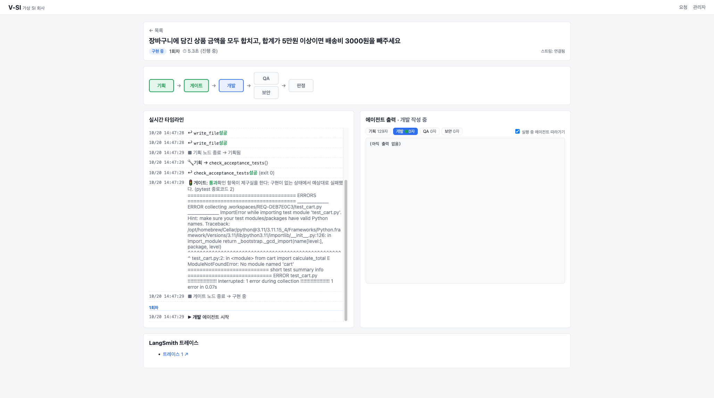

# V-SI : LangGraph 기반 멀티에이전트 가상 SI 개발팀

**말로 요구사항을 적으면, AI 에이전트 네 팀이 기획하고 · 만들고 · 테스트하고 · 보안 검사한다.
반려되면 스스로 고친다.**

> 장바구니에 담긴 상품 금액을 모두 합치고, 합계가 5만원 이상이면 배송비 3000원을 빼주세요

**기획**이 명세와 인수 테스트를 쓰고, **개발**이 그 테스트를 통과하는 코드를 쓰고, **QA**와
**보안**이 실제로 `pytest`·`bandit` 을 돌린다. 하나라도 FAIL 이면 그 사유를 들고 개발로
되돌아간다. 이 과정이 화면에 실시간으로 흐른다.



> AI 캠퍼스 미니프로젝트 (과제 2 · 신규 프로젝트) — 결과 보고서: [`docs/lg/REPORT.md`](docs/lg/REPORT.md)

---

## 무엇으로 만들었나

| 요구사항 | 구현 |
|---|---|
| **LangChain · LangGraph 멀티에이전트** | `StateGraph` 7노드. 에이전트 4종은 `create_agent`(ReAct). QA·보안 **병렬** 실행, 조건부 엣지로 **반려 루프**, `interrupt()` 로 **사람 승인** |
| **MCP 서버** | ① 도구 서버 — 역할마다 별도 MCP 인스턴스 (개발에게는 `run_tests` 가 *존재하지 않는다*) ② 지식 서버 — RAG 검색 tool + `guide://` resource |
| **Vue 기반 UI** | Vue 3 · vue-router. 요청 / 실행 상세 / 관리자 |
| **FastAPI REST API** | 요구사항 · 승인 · 재개 · 결과물 · 피드백 · 관리자 |
| **스트리밍 응답** | SSE — 노드 진행 · 도구 호출 · 판정 · **LLM 토큰**을 실시간 전송, 끊겨도 `?after=` 로 이어받기 |
| **LangSmith 관리자 기능** | 실행 수 · 성공률 · 지연(p95) · 토큰 · 비용 집계, 트레이스 링크, 👍/👎 피드백, **Prompt Hub 프롬프트 버전 교체**(재배포 없이) |
| RAG | bandit 규칙별 보안 조치 가이드 25개 → FAISS. 보안 FAIL 이면 가이드를 찾아 개발에게 넘긴다 |

## 구조

```
 Vue 3 ──SSE/REST──▶ FastAPI ───────────── LangSmith (추적 · 피드백 · Prompt Hub)
                        │
                 LangGraph StateGraph ──── Postgres 체크포인터
  planner → gate ─┬──────────────▶ dev ─┬─▶ qa ───────┬─▶ judge ─┬─▶ 완료 / 에스컬레이션
                  └─▶ approval ────┘    └─▶ security ─┘          └─▶ dev  (반려 사유와 함께)
                     (interrupt)                │
                        │ MCP (역할별 경로)       │ MCP
                        ▼                       ▼
            도구 서버 (인터넷 없는 격리망)       지식 서버 (FAISS RAG)
```

### 설계 원칙

**판정은 모델이 내리지 않는다.** QA·보안 노드는 판정 도구를 *직접* 부르고, PASS/FAIL 은
`pytest`·`bandit` 의 종료코드가 정한다. LLM 은 FAIL 일 때만 불러서, 실패 출력을 개발이 고칠
수 있는 문장으로 옮긴다. PASS 면 LLM 을 아예 부르지 않는다.

**자기 시험지는 자기가 채점하지 못한다.** 개발 에이전트의 MCP 경로에는 `run_tests` 가
등록조차 되어 있지 않고, 인수 테스트 파일에는 쓸 수 없다.

**목표가 비면 시작하지 않는다.** 기획이 쓴 테스트를 구현 없이 돌려 본다. 통과해 버리면 그
테스트는 아무것도 검사하지 않는다는 뜻이므로, 그래프를 멈추고 사람에게 묻는다.

**고친 것을 다시 깨지 않는다.** 판정 노드는 이번에 통과한 검증자의 *이전* 지적도 함께
넘긴다. 보안("md5 금지")과 QA("md5 값을 기대")가 회차마다 번갈아 FAIL 하던 진동을 실측으로
발견하고 넣었다.

**무한히 고치지 않는다.** 회차 상한(3) · 에이전트 턴 상한(8) · 시간 예산(300초) · 도구 호출
상한(90초) · 출력 토큰 상한(2,000)이 층으로 쌓여 있다.

**LLM 이 쓴 코드는 격리된 곳에서만 돈다.** 도구 서버는 인터넷이 없는 `internal` 망의
컨테이너이고, API 키도 없다.

## 실행

`.env` 에 키를 넣는다.

```bash
OPENAI_API_KEY=sk-...
LANGSMITH_API_KEY=lsv2_...
```

```bash
docker compose --profile lg up -d --build postgres workspace knowledge lg-api web-vue
open http://localhost:5180
```

| | 주소 |
|---|---|
| 화면 | http://localhost:5180 |
| API | http://localhost:8200 · 문서 http://localhost:8200/docs |
| 지식 MCP 서버 | http://localhost:8011/mcp/ |

모든 포트는 `127.0.0.1` 에만 열린다 — API 에 인증이 없으므로, 같은 네트워크의 다른 사람이
요구사항을 넣어 OpenAI 한도를 쓰지 못하게 한다.

```bash
curl -X POST localhost:8200/api/requirements -H 'content-type: application/json' \
  -d '{"title":"문자열이 회문인지 판별하는 함수"}'            # → {"requirement_id": "REQ-…"}

curl -N localhost:8200/api/requirements/REQ-…/events          # SSE 실시간 스트림
curl localhost:8200/api/requirements/REQ-…/files              # 만들어진 파일
curl -X POST localhost:8200/api/requirements/REQ-…/approve -d '{"approved":true}' \
  -H 'content-type: application/json'                         # 기획 게이트 승인
curl -X POST localhost:8200/api/requirements/REQ-…/resume     # 서버가 죽었다면 체크포인트에서 재개
```

전체 계약은 [`docs/lg/api-contract.md`](docs/lg/api-contract.md).

## 화면

| 실행 상세 | 관리자 (LangSmith) |
|---|---|
|  |  |

- **실행 상세** — 진행 단계 표시, 실시간 타임라인(도구 호출 · 판정 · RAG 검색), 에이전트별 토큰
  출력, 승인 버튼, 결과 파일 보기, 👍/👎 피드백, LangSmith 트레이스 링크
- **관리자** — 실행 통계, 실행별 비용·지연, 기획 프롬프트 버전 관리, RAG·회차 상한 토글

## Before / After 실측

모델 `gpt-4o-mini`. 원자료 `docs/lg/bench-*.json`, 스크립트 `scripts/bench_lg.py`.

| 개선 | Before | After |
|---|---|---|
| 기획 프롬프트 (3문항 × 2회) | 완료 **0/6**, $0.0056/건, 45.6초 | 완료 **6/6**, $0.0010/건, 12.1초 |
| RAG + 반려 기억 (위험 방식을 지시하는 3문항 × 2회) | 완료 0/6 | 완료 2/6 (토큰 +28%) |
| LLM 토큰 스트리밍 | 0개 (`create_agent` 하위 그래프) | 760개/건 (`subgraphs=True`) |
| 크래시 복구 | — | SIGKILL 후 `/resume` → 끝난 노드는 건너뛰고 이어서 완료 |
| 오케스트레이션 코드 | 3,221줄 (A2A 경로) | 1,111줄 |

한계와 트레이드오프(자동 복구 없음, 이벤트 휘발, 격리 후퇴, RAG 비용, 요구사항-정책 충돌)는
[보고서 4장](docs/lg/REPORT.md#4-한계와-트레이드오프)에 정리했다.

개발 · 시연 · 측정 전체 비용: **74회 실행, $0.22**. 정상 요구사항 1건은 약 $0.001.

## 폴더

```
packages/
  lg_agent/            LangGraph 그래프
    graph.py             StateGraph 조립 · 체크포인터
    nodes/               planner · gate · approval · dev · qa/security · judge
    deps.py              의존성 주입 (LLM · MCP · 프롬프트 저장소 · RAG)
    mcp_tools.py         MCP → LangChain 도구 어댑터
    prompts.py           기획 프롬프트 · Prompt Hub 버전 선택
    knowledge.py         지식 서버 클라이언트
  lg_api/              FastAPI — SSE 스트리밍 · 승인 · 재개 · 관리자(LangSmith)

services/
  tool_server/         MCP 도구 서버 — 역할별로 다른 도구를 마운트
  knowledge_server/    MCP 지식 서버 — 보안 조치 가이드 RAG (FAISS)

web-vue/               Vue 3 화면 — SSE 는 fetch 스트림을 직접 파싱
scripts/bench_lg.py    Before/After 측정
docs/lg/               보고서 · API 계약 · 측정 결과 · 화면
tests/lg_agent  tests/lg_api  tests/knowledge_server
```

## 테스트

```bash
pip install -e ".[dev]"
pytest tests/lg_agent tests/lg_api tests/knowledge_server -q   # 22개
cd web-vue && npm install && npx vitest run                     # 11개
```

가짜 LLM·가짜 도구를 주입해 그래프 전체를 돌리므로 **OpenAI 를 부르지 않는다** (비용 0원).
반려 루프, 회차 상한, 사람 승인 재개, RAG 가이드 전달, SSE 이벤트 순서, 재접속을 검사한다.

## 기술 스택

Python 3.11 · **LangGraph · LangChain** · OpenAI `gpt-4o-mini` · **MCP** · FAISS ·
**FastAPI** (SSE) · **LangSmith** · PostgreSQL · **Vue 3** · Vite · Docker Compose

---

## 기존 구현 (Before 비교군)

이 저장소에는 LangGraph 이전에 직접 만든 구현도 그대로 남아 있다. 같은 네 에이전트가
**각자 독립 컨테이너**로 살고, **A2A 프로토콜**로 일을 주고받고, 자체 오케스트레이터(상태 기계 ·
DB 아웃박스 · 리컨실러)가 흐름을 관리한다. 화면은 React + three.js 3D 사무실이다.

```bash
ollama serve & ollama pull qwen3:8b
VSI_AGENT_MODE=llm docker compose up -d --build    # http://localhost:5173
docker compose up -d --build && ./scripts/demo.sh  # LLM 없이 대본대로 (1초)
```

| | 경로 |
|---|---|
| 오케스트레이터 · 에이전트 루프 | `packages/orchestrator/` · `packages/llm_agent/` · `packages/agent_entry/` |
| 이벤트 중계 · 3D 화면 | `services/event_gateway/` · `web/` |
| 설계 문서 · 결정 기록 | `docs/specs/` · `docs/decisions/` |
| 테스트 | `pytest tests -q --ignore=tests/integration` · `pytest tests/integration -q` (스택 필요) |

Python 3.11 · FastAPI · SQLAlchemy(async) · PostgreSQL · [A2A SDK](https://github.com/google/a2a-python) ·
[MCP](https://modelcontextprotocol.io) · Ollama · OpenTelemetry + Jaeger · React 18 + three.js
