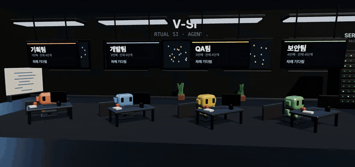
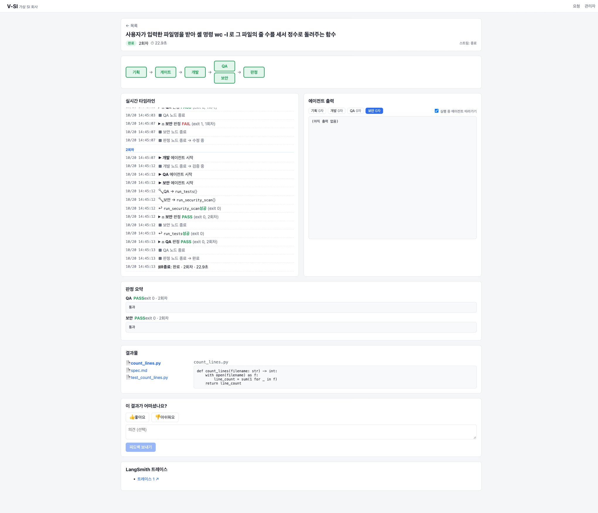
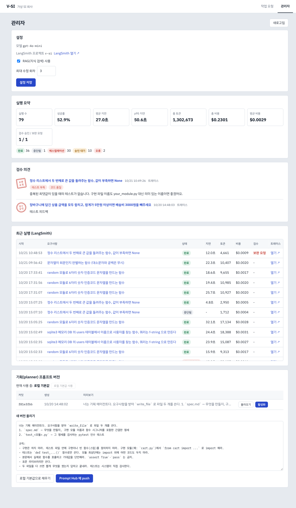

# V-SI — 가상 SI 개발팀

자연어로 요구사항을 적으면 **기획 · 개발 · QA · 보안** 4개의 AI 에이전트가 협업해 코드를 만들고, 테스트로 검증하고, 반려되면 스스로 고칩니다.



## 주요 기능

- **멀티에이전트 협업** — LangGraph 로 기획 → 개발 → QA·보안(병렬) → 판정 흐름을 구성하고, FAIL 이면 사유와 함께 개발로 되돌아갑니다
- **실제 검증** — PASS/FAIL 은 모델이 아니라 `pytest`·`bandit` 결과로 정합니다
- **실시간 스트리밍** — 에이전트 진행 상황과 LLM 출력을 SSE 로 화면에 보여줍니다
- **3D 사무실** — 에이전트가 일하고, 서류를 들고 다음 팀에게 걸어가고, 반려되면 빨간 서류를 들고 돌아옵니다 (three.js, 다시 보기 지원)
- **보안 RAG** — 보안 검사에 걸리면 조치 가이드를 검색해 개발 에이전트에게 전달합니다
- **관리자 대시보드** — LangSmith 기반 실행 통계·비용·피드백, 프롬프트 버전 관리

## 아키텍처

```
Vue 3  ──SSE / REST──▶  FastAPI  ──▶  LangSmith
                           │
                    LangGraph StateGraph
        기획 → 게이트 → 개발 → QA ∥ 보안 → 판정 ─┐
                          ▲                      │ 반려
                          └──────────────────────┘
                           │ MCP
              ┌────────────┴────────────┐
         도구 서버 (격리 실행)       지식 서버 (FAISS RAG)
```

## 기술 스택

| 영역 | 사용 기술 |
|---|---|
| 멀티에이전트 | LangGraph, LangChain (`create_agent`), OpenAI `gpt-4o-mini` |
| 도구 연동 | MCP 서버 2개 — 코드 실행 도구 서버, RAG 지식 서버 |
| 백엔드 | FastAPI, SSE 스트리밍, PostgreSQL 체크포인터 |
| 프론트엔드 | Vue 3, Vite, three.js |
| 관측·관리 | LangSmith (트레이스, 피드백, Prompt Hub) |
| RAG | FAISS, OpenAI Embeddings |

## 실행

`.env` 에 키를 넣고 Docker 로 실행합니다.

```bash
OPENAI_API_KEY=sk-...
LANGSMITH_API_KEY=lsv2_...
```

```bash
docker compose --profile lg up -d --build postgres workspace knowledge backend frontend
```

- 화면: http://localhost:5180
- API 문서: http://localhost:8200/docs

## 화면

| 실행 상세 | 관리자 (LangSmith) |
|---|---|
|  |  |

## 결과

같은 요구사항을 개선 전후로 실행해 비교했습니다 (`gpt-4o-mini`).

| 개선 항목 | Before | After |
|---|---|---|
| 기획 프롬프트 개선 — 완료율 | 0 / 6 | 6 / 6 |
| 기획 프롬프트 개선 — 건당 비용 | $0.0056 | $0.0010 |
| RAG + 반려 기억 — 보안 함정 문항 완료 | 0 / 6 | 2 / 6 |

자세한 분석과 한계는 [결과 보고서](docs/lg/REPORT.md)에 정리했습니다.

## 프로젝트 구조

```
V-SI/
├── frontend/                 Vue 3 화면
│   └── src/
│       ├── views/            요청 · 실행 상세 · 관리자 페이지
│       ├── components/       타임라인, 에이전트 출력, 3D 사무실 등
│       ├── office/           3D 사무실 (three.js)
│       └── api/              REST 클라이언트, SSE 파서
├── backend/
│   ├── lg_api/               FastAPI 서버 (REST, SSE, 관리자 API)
│   └── lg_agent/             LangGraph 그래프
│       ├── graph.py          워크플로 정의
│       ├── nodes/            기획 · 개발 · QA/보안 · 판정 노드
│       └── ...               설정, 의존성 주입, MCP 연동, 프롬프트
├── mcp_servers/
│   ├── tool_server/          코드 실행 도구 서버 (격리망)
│   └── knowledge_server/     보안 가이드 RAG 서버
├── tests/                    단위 · 통합 테스트
├── scripts/                  실측 스크립트
├── docs/lg/                  보고서, API 명세, 실측 결과
└── legacy/                   이전 버전 (A2A 기반, 비교용)
```

## 테스트

```bash
pytest tests/lg_agent tests/lg_api tests/knowledge_server
cd frontend && npx vitest run
```

테스트는 가짜 LLM 을 사용해 API 비용이 들지 않습니다.

## 참고

`legacy/` 에는 LangGraph 로 옮기기 전의 이전 버전(A2A 프로토콜, 에이전트별 독립 컨테이너,
React 3D 화면)이 Before 비교군으로 남아 있습니다.
