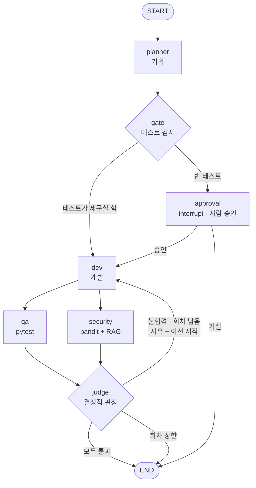
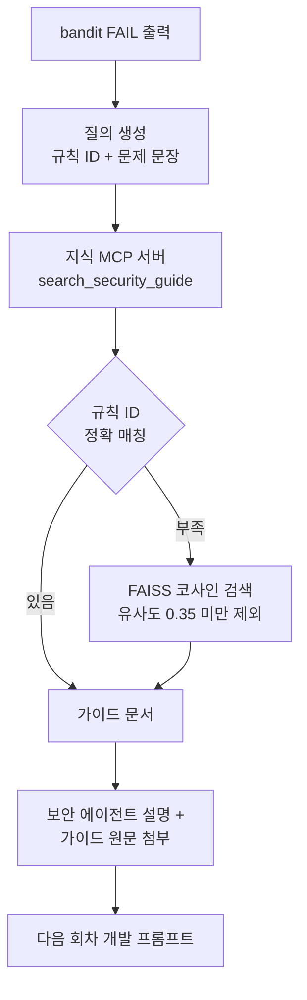
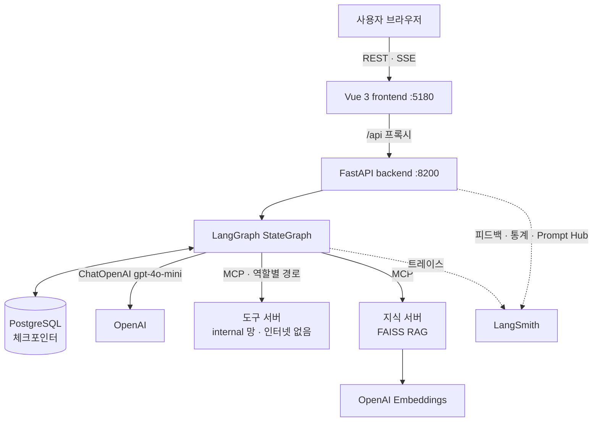
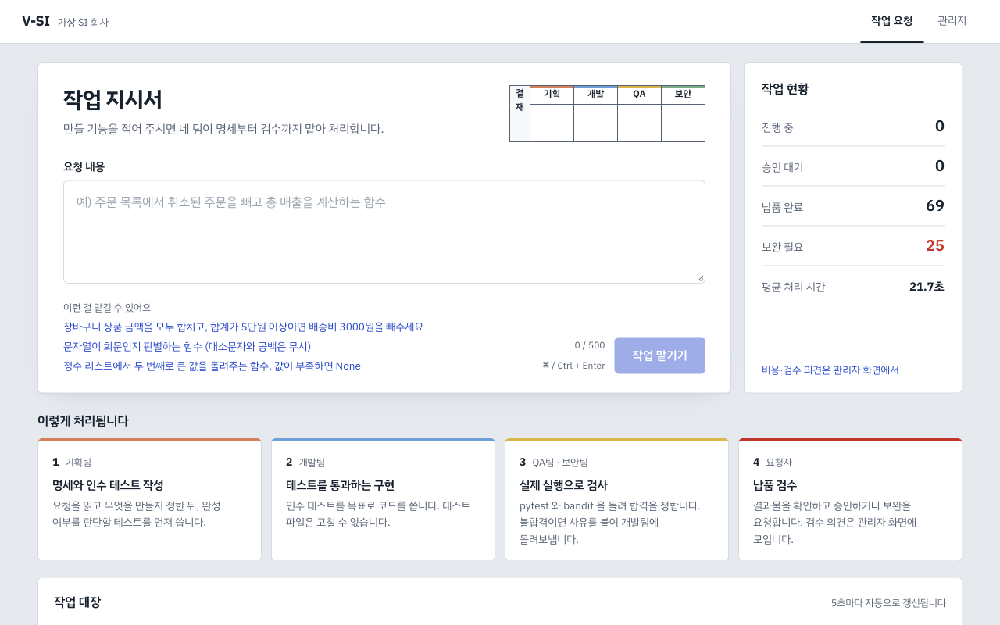
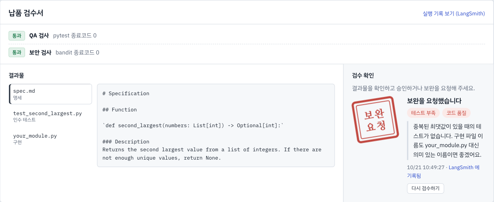

# V-SI : LangGraph 기반 멀티에이전트 가상 SI 개발팀

| | |
|---|---|
| **소속** | SKALA `<지역>` `<반>` |
| **고유번호 · 이름** | `<고유번호>` `<이름>` |
| **과제** | AI Mini-Project · 과제 2 (신규 프로젝트 개발) |
| **저장소** | https://github.com/skeey66/V-SI |
| **작성일** | 2026-10-21 |

자연어로 요구사항을 적으면 **기획 · 개발 · QA · 보안** 4개의 AI 에이전트가 협업해 코드를 만들고,
실제 테스트로 검증하고, 반려되면 스스로 고칩니다. 마지막에는 사람이 결과물을 검수합니다.


**목차**
1. [문제 개선 및 신규 구현 사항](#1-문제-개선-및-신규-구현-사항)
2. [적용 기술 요소](#2-적용-기술-요소)
3. [구현 결과](#3-구현-결과)
4. [교훈](#4-교훈)
5. [부록 — 실행 방법](#부록--실행-방법)

---

## 1. 문제 개선 및 신규 구현 사항

### 1-1. 기존 시스템의 문제점

이 프로젝트는 직접 만들었던 V-SI 첫 버전을 다시 설계한 것입니다. 첫 버전은 에이전트 4개가 각자
독립 컨테이너로 떠서 **A2A 프로토콜**로 일을 주고받고, 자체 오케스트레이터(상태 기계 · DB 아웃박스 ·
리컨실러)가 흐름을 관리하는 구조였습니다.

| 문제 | 내용 |
|---|---|
| 느린 처리 | 로컬 `qwen3:8b` 로 요구사항 한 건에 **10~20분** |
| 무거운 오케스트레이션 | 흐름 제어 코드만 **3,221줄** — 상태 전이 · 재시도 · 복구를 모두 직접 구현 |
| 관측의 한계 | 비용 · 토큰 · 사용자 만족도를 볼 수 없음 (Jaeger 트레이스만 있음) |
| 보안 지적을 못 고침 | bandit 이 FAIL 을 내도 개발 에이전트가 **어떻게** 고칠지 몰라 회차를 소진 |
| 사용자 경험 | 결과를 받아도 평가할 방법이 없고, 진행 중 LLM 출력이 보이지 않음 |

### 1-2. 해결 과제

1. 협업 흐름을 **LangGraph `StateGraph`** 로 옮겨 그래프 한 장으로 읽히게 한다
2. 기존 **MCP 도구 서버**(역할별 권한 분리)는 그대로 살리고, **RAG 지식 서버**를 MCP 로 추가한다
3. **FastAPI + SSE** 로 진행 상황과 LLM 토큰을 실시간으로 보여준다
4. **Vue** 화면에서 요청 · 진행 · 검수까지 하고, **LangSmith** 로 비용 · 품질을 관리한다
5. 같은 입력으로 **Before / After 를 실측**해서 개선을 숫자로 증명한다

### 1-3. 구현 · 개선한 핵심 기능

| 기능 | 설명 |
|---|---|
| 자동 개발 파이프라인 | 요구사항 하나로 명세 → 인수 테스트 → 구현 → 검사까지 자동 진행 |
| 실행 기반 판정 | 합격/불합격은 모델이 아니라 `pytest` · `bandit` 종료코드가 정함 |
| 반려 루프 + 반려 기억 | 불합격이면 사유와 함께 개발로 되돌림. 이전 회차 지적도 함께 넘겨 같은 실수를 반복하지 않게 함 |
| 보안 조치 가이드 RAG | bandit 규칙별 가이드를 검색해 "이렇게 고쳐라"를 개발 피드백에 첨부 |
| 사람 승인 게이트 | 기획이 쓴 테스트가 아무것도 검사하지 않으면 그래프를 멈추고 사람에게 물음 |
| 실시간 진행 화면 | 3D 사무실 · 타임라인 · 에이전트별 토큰 출력 (SSE) |
| 납품 검수 | 승인 / 보완 요청(사유 선택)을 검수 도장으로 남기고 LangSmith 피드백으로 기록 |
| 관리자 | 실행 수 · 성공률 · 지연 · 토큰 · 비용, 검수 의견, 프롬프트 버전 교체 |
| 장애 복구 | 서버가 죽어도 Postgres 체크포인트에서 이어 실행, 재시작 시 작업 대장 복원 |

---

## 2. 적용 기술 요소

### 2-1. Multi-Agent & LangGraph



| 요소 | 구현 |
|---|---|
| **전문 서브에이전트 분리** | 기획 · 개발 · QA · 보안이 각각 `create_agent`(ReAct) 하위 그래프. 역할마다 프롬프트와 **MCP 경로가 달라서** 쓸 수 있는 도구가 구조적으로 다름 (개발에게는 `run_tests` 가 존재하지 않음) |
| **병렬 실행** | QA 와 보안은 서로의 결과가 필요 없어 fan-out, 판정은 둘 다 끝나야 실행(fan-in) |
| **동적 재계획** | 판정이 불합격이면 실패 사유와 *이전 회차의 지적까지* 상태(`feedback`)에 담아 개발로 되돌림 — 개발 에이전트는 매 회차 새 지적을 보고 계획을 다시 세움 |
| **Human-in-the-loop** | `interrupt()` 로 멈추고 `Command(resume=…)` 로 재개 |
| **Supervisor 대신 결정적 판정** | LLM supervisor 가 다음 단계를 고르게 하지 않고, `judge` 노드가 **도구 종료코드로** 라우팅. "통과했다고 생각한다"가 통과가 되는 경로를 없애기 위한 선택 (4장 트레이드오프 참고) |
| **상한** | 회차 3 · 에이전트 턴 8(`recursion_limit`) · 시간 예산 300초 · 도구 호출 90초 · 출력 2,000토큰 |

코드: [`backend/lg_agent/graph.py`](backend/lg_agent/graph.py), [`backend/lg_agent/nodes/`](backend/lg_agent/nodes/)

### 2-2. MCP — Tool · Resource · Prompt

MCP 서버 두 개를 씁니다.

| 서버 | 기능 | 내용 |
|---|---|---|
| **도구 서버** `mcp_servers/tool_server` | Tool 7종 | `write_file` `read_file` `list_files` `run_tests` `run_security_scan` `run_lint` `check_acceptance_tests`. 역할마다 **별도 MCP 인스턴스**(`/mcp/planner/` …)에 허용된 도구만 등록. 인터넷이 없는 격리망 컨테이너에서 실행 |
| **지식 서버** `mcp_servers/knowledge_server` | **Tool** | `search_security_guide(query, k)` — 보안 가이드 의미 검색 |
| | **Resource** | `guide://security/{rule_id}` — 규칙 ID 로 원문 조회 |
| | **Prompt** | `security_fix_request(bandit_output)` — bandit 결과에 맞는 가이드를 붙인 수정 요청문 |

- 모델에게 보이는 도구 스키마에서 `requirement_id` 를 지우고, 호출할 때 세션 값으로 덮어씁니다.
  모델이 다른 요구사항의 작업 공간을 가리킬 방법이 없습니다.
- 공식 `langchain-mcp-adapters` 는 `mcp==2.2.0` 에서 import 오류가 나서, MCP 도구를 LangChain
  `StructuredTool` 로 감싸는 얇은 어댑터를 직접 만들었습니다 ([`mcp_tools.py`](backend/lg_agent/mcp_tools.py)).

### 2-3. RAG — Vector DB 기반 의미 검색과 문서 주입



- 문서: bandit 규칙별 조치 가이드 **25개** (위험 · 고치는 방법 · 예시 코드)
- 임베딩: OpenAI `text-embedding-3-small`, **FAISS** `IndexFlatIP`. 문서 해시로 디스크에 캐시해 문서가 바뀔 때만 다시 임베딩
- 검색: 규칙 ID 정확 매칭을 먼저, 모자라면 의미 검색. 관련 없는 문서가 프롬프트를 오염시키지 않도록 유사도 임계값 적용
- 주입: 모델이 요약하며 빠뜨려도 개발이 원문을 받도록 가이드를 피드백에 그대로 붙임

### 2-4. 아키텍처 및 코드 품질

```
V-SI/
├── frontend/          Vue 3 화면 (views · components · office(3D) · api)
├── backend/
│   ├── lg_api/        FastAPI — REST · SSE · 관리자 API
│   └── lg_agent/      LangGraph — graph · nodes · deps · mcp · prompts
├── mcp_servers/       도구 서버 · 지식 서버
├── tests/             단위 · 통합 테스트
├── scripts/           Before/After 실측 · LLM-as-a-Judge 평가
└── legacy/            첫 버전 (A2A) — Before 비교군
```

- **모듈화**: 노드 · 상태 · 의존성 · MCP 연동 · 프롬프트 · 설정을 파일 단위로 분리
- **의존성 주입**: 노드는 LLM · MCP 를 직접 만들지 않고 `Deps` 로 받음 → 테스트에서 가짜 LLM · 가짜 도구를 꽂아 그래프 전체를 네트워크 없이 실행 ([`deps.py`](backend/lg_agent/deps.py))
- **단위 테스트**: 새 코드 **파이썬 25개**(그래프 흐름 10 · API 10 · RAG 인덱스 5) + **프런트 39개**(SSE 파서 · 3D 사무실 상태 · 변환기 등). 전체 파이썬 320개 통과. 가짜 LLM 이라 **API 비용 0원**
- **CI**: GitHub Actions 에서 LangGraph · Vue 테스트를 따로 실행

### 2-5. 관측 가능성 및 평가 — LangSmith · LLM-as-a-Judge

**트레이싱.** 모든 실행이 LangSmith 에 루트 실행 `vsi-graph` 로 남고, 그 아래 노드 · LLM 호출 · 도구 호출이
트리로 기록됩니다. 메타데이터(`requirement_id`, `rag`, `prompt_commit`)로 실행을 거르고 비교합니다.

**관리자 기능** (모두 LangSmith 를 데이터 원천으로 사용)
- 실행 수 · 성공률 · 평균/p95 지연 · 토큰 · 비용 집계, 실행별 트레이스 링크
- 사용자 검수 의견(점수 · 보완 사유 · 의견)을 LangSmith 피드백으로 기록하고 모아 보기
- **Prompt Hub** 로 기획 프롬프트 버전을 올리고, 재배포 없이 활성 버전 교체
- RAG · 회차 상한 런타임 토글

**LLM-as-a-Judge.** 합격 판정이 테스트 종료코드라서, *테스트가 요구사항을 덜 담으면 그대로 통과*하는
약점이 있습니다. 그래서 테스트 통과와 별개로 LLM 심판이 **요구사항 충실도**를 1~5점으로 채점하는
LangSmith 실험을 만들었습니다 ([`scripts/eval_judge.py`](scripts/eval_judge.py)).

| 요구사항 (데이터셋 `vsi-eval`) | 완료 | 회차 | 충실도 | 심판 근거 (요약) |
|---|---|---|---|---|
| 장바구니 합계 · 5만원 이상 배송비 할인 | ✅ | 1 | 5 | 경계값 50,000원 테스트 포함 |
| 회문 판별 (대소문자 · 공백 무시) | ✅ | 2 | 5 | 조건 모두 검사 |
| 두 번째로 큰 값, 부족하면 None | ✅ | 1 | 5 | 조건 모두 검사 |
| 섭씨→화씨, 절대영도 미만이면 ValueError | ✅ | 2 | 5 | 예외 처리와 변환 모두 검사 |
| 이메일 형식 검사, 공백이면 False | ❌ | 3 | 4 | `user@domain..com` 같은 경계값 테스트 부족 |
| **평균** | **4/5** | **1.8** | **4.8 / 5** | |

이메일 문항은 자동 판정(회차 상한 도달)과 심판의 지적(경계값 부족)이 같은 곳을 가리킵니다.

### 2-6. 기타 적용 기술

| 기술 | 사용처 |
|---|---|
| **SSE 스트리밍** | 노드 진행 · 도구 호출 · 판정 · RAG · **LLM 토큰**을 실시간 전송, `?after=` 로 재접속 시 이어받기 |
| **Postgres 체크포인터** | 서버가 죽어도 마지막 노드부터 재개(`/resume`), 재시작 시 작업 대장 복원 |
| **three.js 3D 사무실** | 에이전트 진행을 캐릭터가 서류를 나르는 장면으로, 끝난 실행은 다시 보기 |
| **Docker 격리** | LLM 이 쓴 코드는 인터넷 · API 키가 없는 `internal` 망 컨테이너에서만 실행. 서비스 포트는 `127.0.0.1` 에만 개방 |

---

## 3. 구현 결과

### 3-1. 전체 아키텍처



### 3-2. 시연 시나리오

| 단계 | 화면 |
|---|---|
| **① 작업 지시서에 요청을 적는다** — 결재란(기획 · 개발 · QA · 보안)이 네 팀의 처리를 예고 |  |
| **② 실시간으로 진행을 본다** — 3D 사무실에서 서류가 오가고, 타임라인과 에이전트 출력이 SSE 로 흐른다. 보안이 반려하면 빨간 서류를 들고 개발에게 돌아간다 (맨 위 GIF) |  |
| **③ 납품 검수서를 받는다** — 자동 검사 결과와 결과물 파일을 보고 승인하거나, 사유를 골라 보완을 요청한다. 검수 도장이 찍히고 LangSmith 에 기록된다 |  |
| **④ 관리자가 품질과 비용을 본다** — 실행 통계, 검수 의견, 프롬프트 버전 |  |

### 3-3. Before / After 실측

같은 요구사항을 개선 전후로 실행해 비교했습니다 (모델 `gpt-4o-mini`, 원자료 `docs/lg/bench-*.json`).

| 개선 | Before | After |
|---|---|---|
| **기획 프롬프트** — 모델이 도구 이름을 테스트 코드에 적던 문제 (3문항 × 2회) | 완료 **0/6**, 건당 $0.0056, 45.6초 | 완료 **6/6**, 건당 **$0.0010**, **12.1초** |
| **RAG + 반려 기억** — 위험한 방식을 지시하는 3문항 × 2회 | 완료 0/6 | 완료 **2/6** (토큰 +28%) |
| **토큰 스트리밍** — 하위 그래프의 LLM 토큰 | 0개 | 요구사항 1건에 **760개** (`subgraphs=True`) |
| **오케스트레이션 코드** | 3,221줄 (A2A 경로) | 전환 시점 **1,111줄** |
| **처리 시간** | 10~20분 (로컬 qwen3:8b) | 10~30초 (gpt-4o-mini) — *모델이 달라 직접 비교는 아님* |
| **크래시 복구** | 리컨실러가 자동 재디스패치 | 체크포인트에서 `/resume` — SIGKILL 후 끝난 노드는 건너뛰고 이어서 완료 |

개발 · 시연 · 측정 · 평가 전체 OpenAI 비용은 **약 $0.25** 입니다. 정상 요구사항 한 건은 약 $0.001 입니다.

---

## 4. 교훈

### 4-1. 한계와 트레이드오프

| 선택 | 얻은 것 | 잃은 것 |
|---|---|---|
| LLM supervisor 대신 **결정적 판정** | 근거 없는 통과가 구조적으로 불가능, 판정 비용 0 | 상황에 따라 순서를 바꾸는 유연성 (예: 보안만 다시 돌리기) |
| 에이전트 4개를 **한 그래프의 노드**로 | 코드 1/3, 흐름이 그래프 한 장으로 읽힘 | 에이전트별 독립 배포 · 수평 확장, 컨테이너 단위 장애 격리 |
| **체크포인터** 복구 | 상태 보존, 끝난 노드 재실행 없음 | 자동 재시작은 없음(수동 `/resume`), 진행 타임라인은 메모리라 재시작 시 사라짐 |
| **RAG** 가이드 주입 | 위험 지시 문항 0/6 → 2/6 | 실행당 토큰 약 +28%, 임베딩 서버 하나 더 운영. 표본이 조건당 10회라 효과 크기는 불확실 |
| 테스트 종료코드 판정 | 모델의 주관 배제 | 테스트 품질에 그대로 의존 → LLM-as-a-Judge 로 보완했지만, 심판이 생성 모델과 같은 계열(gpt-4o-mini)이라 점수가 후할 수 있음 |
| 공식 MCP 어댑터 대신 **자체 어댑터** | `mcp 2.x` 와 호환 | 공식 어댑터의 콜백 · 리소스 로딩을 직접 관리해야 함 |

**에이전트가 풀 수 없는 문제도 있었습니다.** "비밀번호를 md5 로 해시하라"는 요구사항은 어떤 조건에서도
완료되지 않았습니다. 요구사항 자체가 보안 정책과 충돌하기 때문입니다. 회차 상한이 손실을 묶어 둘 뿐,
이런 문제는 사람이 결정해야 합니다.

### 4-2. 향후 추가 개선 사항

1. **기획 단계에서 정책 충돌 감지** — 위험한 방식을 지시하는 요구사항은 개발 전에 `interrupt()` 로 사람에게 묻는다
2. **이벤트 영속화** — SSE 이벤트를 DB 에 남겨 재시작 후에도 타임라인 복원
3. **기동 시 자동 재개** — 멈춘 체크포인트를 찾아 스스로 `/resume`
4. **심판 모델 분리** — 생성 모델과 다른 계열의 심판으로 편향을 줄이고, 평가 결과로 프롬프트 버전을 자동 비교
5. **과거 성공 사례 RAG** — 승인된 명세 · 테스트를 기획의 예시로 검색
6. **인증** — 지금 API 에는 인증이 없어 `127.0.0.1` 바인딩으로만 막고 있음

### 4-3. 수행 소감

<!-- 아래는 초안입니다. 본인의 말로 고쳐 주세요. -->

- **모델을 믿지 않는 구조가 가장 큰 개선을 만들었다.** 기획 프롬프트 한 문장("마지막에 도구를 호출해라")을
  모델이 코드로 적어 버리는 바람에 완료율이 0% 였다. 프롬프트를 고친 것보다, 판정을 도구가 직접 하도록
  구조를 바꾼 것이 더 근본적인 해결이었다.
- **실측해야 보이는 것들이 있었다.** 판정이 회차마다 뒤집히는 진동, 하위 그래프 토큰이 스트림에 안 나오는
  문제, 포트가 외부에 열려 있던 문제는 모두 직접 돌려 보고서야 발견했다.
- **좋아 보이는 기능도 숫자로 확인해야 한다.** RAG 는 기대만큼 극적이지 않았고(전체 완료율 차이는 오차 범위),
  비용도 늘었다. 그대로 기록하는 것이 다음 개선의 출발점이라고 생각한다.
- 프레임워크(LangGraph)로 옮기면서 직접 만든 코드의 2/3 가 사라졌지만, 그만큼 직접 보장하던 것(자동 복구,
  이벤트 영속성)도 함께 사라졌다는 것을 배웠다.

---

## 부록 — 실행 방법

`.env` 에 키를 넣고 Docker 로 실행합니다.

```bash
OPENAI_API_KEY=sk-...
LANGSMITH_API_KEY=lsv2_...
```

```bash
docker compose --profile lg up -d --build postgres workspace knowledge backend frontend
```

- 화면: http://localhost:5180 · API 문서: http://localhost:5180/api/docs

```bash
pytest tests/lg_agent tests/lg_api tests/knowledge_server   # 가짜 LLM, 비용 0원
cd frontend && npx vitest run
PYTHONPATH=backend python scripts/eval_judge.py              # LLM-as-a-Judge (약 $0.02)
```

상세 분석: [`docs/lg/REPORT.md`](docs/lg/REPORT.md) · API 명세: [`docs/lg/api-contract.md`](docs/lg/api-contract.md) ·
첫 버전(A2A)은 [`legacy/`](legacy/) 에 비교용으로 남아 있습니다.
