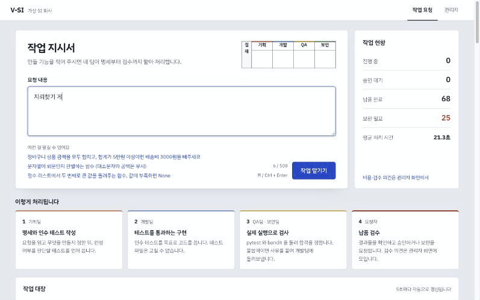
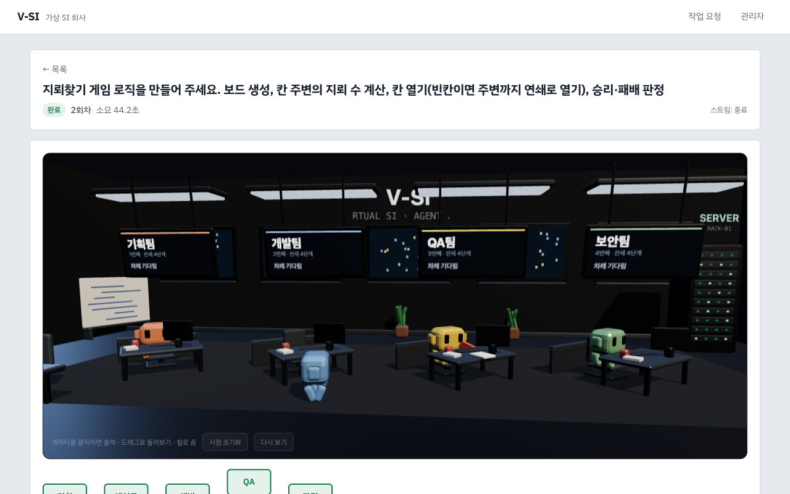
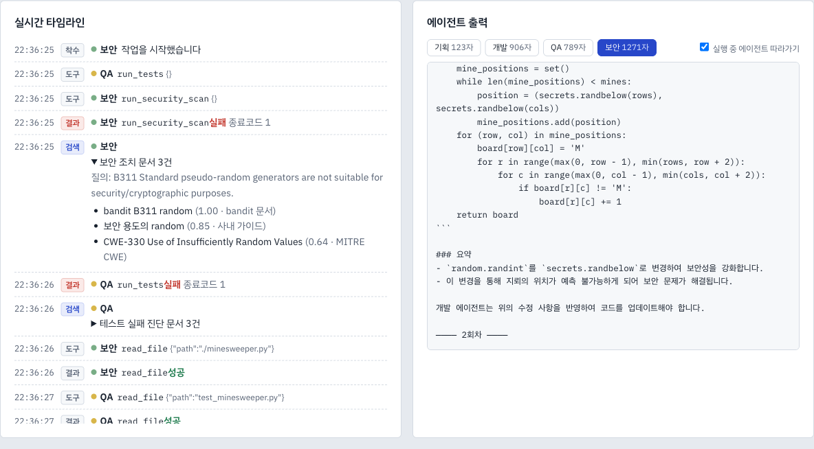
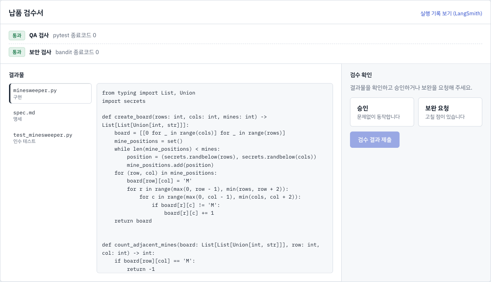
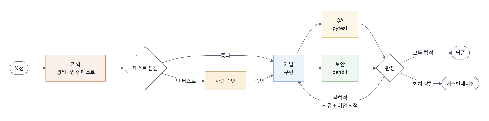
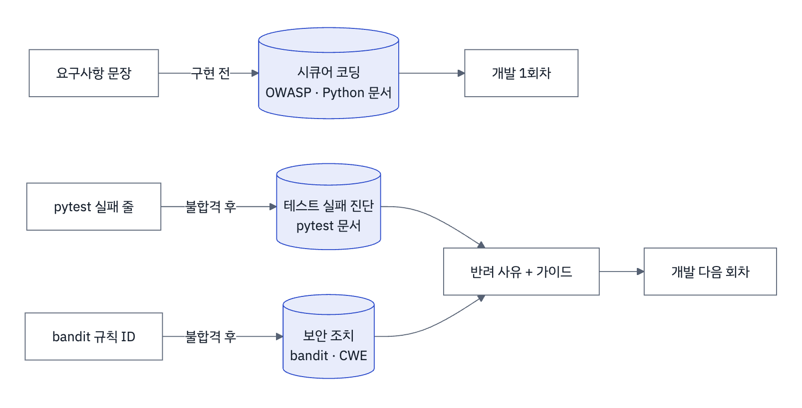
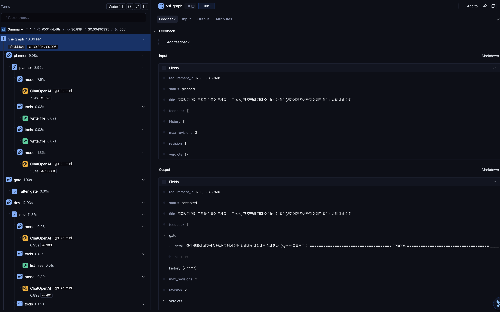
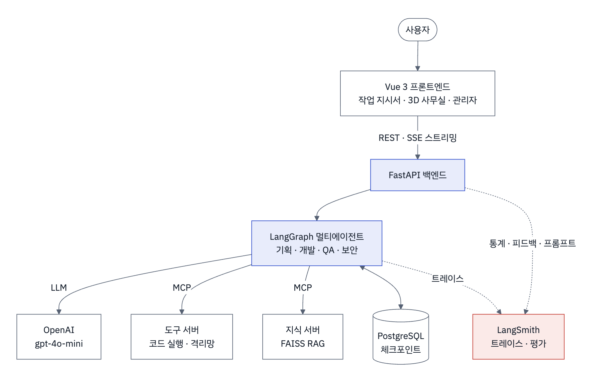

# V-SI : LangGraph 기반 멀티에이전트 가상 SI 개발팀

| **소속** | SKALA 광주캠퍼스 2반 |
|:---|:---|
| **고유번호 · 이름** | G042 김승현 |
| **저장소** | https://github.com/skeey66/V-SI |
| **작성일** | 2026-10-22 |

<br>

만들고 싶은 기능을 문장으로 적으면 **기획 · 개발 · QA · 보안** 네 AI 에이전트가 명세와 테스트를 쓰고,
코드를 만들고, 실제로 검사합니다.

검사에 떨어지면 이유를 들고 다시 고치고, 마지막에는 사람이 결과물을 검수합니다.

<br>



<br>

## 목차

1. [문제와 개선](#1-문제와-개선)
   - 기존 시스템의 문제 · 핵심 기능
2. [화면 구성](#2-화면-구성)
   - 메인 · 3D 사무실 · 타임라인 · 납품 검수서 · 관리자
3. [적용 기술](#3-적용-기술)
   - LangGraph · MCP · RAG · 코드 품질 · LangSmith
4. [구현 결과](#4-구현-결과)
   - 전체 아키텍처 · 시연 · Before / After
5. [교훈](#5-교훈)
   - 한계와 트레이드오프 · 향후 개선 · 수행 소감
6. [실행 방법](#6-실행-방법)

<br>

---

## 1. 문제와 개선

> 직접 만들었던 첫 버전(A2A 프로토콜 + 자체 오케스트레이터 + 로컬 모델)을 LangGraph 로 다시 설계했습니다.

<br>

### 1-1. 기존 시스템의 문제와 개선

| 기존 문제 | 개선 |
|:---|:---|
| 요구사항 한 건에 10~20분 (로컬 `qwen3:8b`) | `gpt-4o-mini` 로 10~30초 |
| 흐름 제어를 직접 구현해 코드 3,221줄 | LangGraph 그래프로 옮겨 1,111줄 |
| 보안 문제를 찾아도 고치는 방법을 모름 | 공개 문서 기반 RAG 로 조치 가이드 제공 |
| 진행 중 LLM 출력과 비용이 보이지 않음 | SSE 실시간 화면 + LangSmith 관리자 |
| 결과를 평가할 방법이 없음 | 검수 확인(승인 · 보완 요청) → LangSmith 피드백 |

<br>

### 1-2. 핵심 기능

| 기능 | 내용 |
|:---|:---|
| **자동 개발 파이프라인** | 요구사항 하나로 명세 → 인수 테스트 → 구현 → 검사 |
| **실행 기반 판정** | 합격은 모델이 아니라 `pytest` · `bandit` 종료코드가 정함 |
| **반려 루프** | 불합격 사유와 이전 회차 지적을 함께 개발에 돌려줌 |
| **단계별 RAG** | 구현 전에는 시큐어 코딩, 불합격 뒤에는 원인별 조치 가이드 |
| **사람 승인 · 검수 · 복구** | 빈 테스트면 멈추고 묻기, 검수 도장, 체크포인트에서 재개 |

<br>

---

## 2. 화면 구성

> 콘셉트는 **"가상 SI 회사의 결재 서류"** 입니다. 요청은 작업 지시서, 결과는 납품 검수서, 사람의 판단은 인주색 도장으로 표현했습니다.

<br>

### 2-1. 메인 — 작업 지시서

요청을 적는 곳입니다.

오른쪽 위 결재란(기획 · 개발 · QA · 보안)이 네 팀의 처리 순서를, 오른쪽 패널이 작업 현황을 보여줍니다.


<br>

### 2-2. 실행 상세 — 3D 사무실

일하는 팀은 모니터가 켜지고, 일이 넘어가면 캐릭터가 서류를 들고 다음 팀으로 걸어갑니다.

반려되면 빨간 서류를 들고 돌아오며, 끝난 실행은 **다시 보기**로 재생할 수 있습니다.



<br>

### 2-3. 실행 상세 — 타임라인과 에이전트 출력

도구 호출 · 판정 · 검색이 시간순으로 쌓이고, 오른쪽에는 LLM 출력이 토큰 단위로 흐릅니다.

아래는 보안 검사가 `random` 사용(B311)으로 실패하자 **bandit 문서 · 사내 가이드 · CWE** 를 검색한 장면입니다.



<br>

### 2-4. 실행 상세 — 납품 검수서

자동 검사 결과와 결과물 파일을 보고 **승인**하거나, 사유를 골라 **보완을 요청**합니다.

제출하면 검수 도장이 찍히고 LangSmith 에 기록됩니다.

| 검수서 | 검수 도장 |
|:---:|:---:|
|  |  |

<br>

### 2-5. 관리자

LangSmith 실행 기록으로 **통계 · 비용 · 검수 의견**을 보여줍니다.

RAG 단계를 켜고 끄거나 기획 프롬프트 버전을 바꿀 수도 있습니다.


<br>

---

## 3. 적용 기술

> 멀티에이전트는 LangGraph, 도구와 지식은 MCP, 관측과 평가는 LangSmith 로 구성했습니다.

<br>

### 3-1. Multi-Agent & LangGraph



| 요소 | 구현 |
|:---|:---|
| **전문 서브에이전트** | 네 역할이 각각 `create_agent` 하위 그래프. 역할마다 프롬프트와 MCP 도구가 달라, 개발에게는 `run_tests` 가 아예 없음 |
| **병렬 실행** | QA 와 보안이 동시에 돌고, 판정은 둘이 끝난 뒤 실행 |
| **동적 재계획** | 불합격 사유와 이전 지적을 상태에 담아 개발로 되돌림 |
| **Human-in-the-loop** | `interrupt()` 로 멈추고 `Command(resume=...)` 로 재개 |
| **결정적 판정** | LLM supervisor 대신 도구 종료코드로 라우팅해 근거 없는 통과를 막음 |

<br>

### 3-2. MCP

| 서버 | 제공 기능 |
|:---|:---|
| **도구 서버** | Tool 7종(`write_file` `read_file` `run_tests` `run_security_scan` …)<br>역할별 MCP 인스턴스, 인터넷 없는 격리망 |
| **지식 서버** | Tool `search_guides` · Resource `guide://{묶음}/{id}`<br>Prompt `security_fix_request` · `test_design_brief` |

<br>

### 3-3. RAG



OWASP Cheat Sheet · bandit 공식 문서 · MITRE CWE · pytest · Python 공식 문서를 수집하고 사내 가이드를 더해,
**문서 165개(청크 752개)** 를 네 묶음의 FAISS 인덱스로 만들었습니다.

규칙 ID 나 오류 이름이 맞으면 가산점을 주는 의미 검색을 쓰고, 검색 결과에는 출처가 붙습니다.

<br>

**단계별 효과 측정** — 조건마다 요구사항 5개를 2번씩 실행

| 지표 | RAG 끔 | 4단계 전부 | 기본 3단계 |
|:---|:---:|:---:|:---:|
| 보안 함정 — 1회차 보안 통과 | 1/10 | 5/10 | **4/10** |
| 보안 함정 — 완료 | 5/10 | 6/10 | **6/10** |
| 일반 요구사항 — 완료 | 10/10 | 8/10 | **10/10** |
| 일반 요구사항 — 평균 회차 | 1.3 | 2.0 | **1.1** |

- 시큐어 코딩 RAG 가 가장 효과가 컸습니다.
- 테스트 설계 RAG 는 기획이 기대값이 틀린 테스트(회문이 아닌 `"한글가나다한글가나다"` 를 회문이라 단언)를
  쓰게 만들어 완료율을 떨어뜨렸습니다. 그래서 기본에서 뺐습니다.

<br>

### 3-4. 아키텍처와 코드 품질

```
frontend/      Vue 3 화면
backend/       lg_api   — FastAPI · SSE · 관리자 API
               lg_agent — LangGraph · RAG · MCP 연동
mcp_servers/   도구 서버 · 지식 서버
tests/  scripts/  docs/  legacy/(첫 버전, 비교용)
```

| 항목 | 내용 |
|:---|:---|
| **의존성 주입** | 노드가 LLM · MCP 를 `Deps` 로 받아, 테스트에서 가짜를 꽂아 그래프 전체를 네트워크 없이 실행 |
| **단위 테스트** | 새로 작성한 파이썬 33개 · 프런트엔드 39개, 전체 파이썬 328개 통과 (API 비용 0원) |
| **CI** | GitHub Actions 에서 LangGraph · Vue 테스트 실행 |

<br>

### 3-5. LangSmith — 관측과 평가

모든 실행이 LangSmith 트레이스로 남습니다. 아래는 지뢰찾기 요청의 트레이스입니다.

노드 순서, 노드별 LLM 호출과 토큰, MCP 도구 호출, 조건 분기가 보이고,
이 한 건이 **44초 · 30.9K 토큰 · $0.0049** 였다는 것도 바로 확인됩니다.



| 용도 | 내용 |
|:---|:---|
| **관리자 통계** | 관리자 화면이 LangSmith API 로 실행 수 · 지연 · 토큰 · 비용을 집계 |
| **사용자 피드백** | 검수 결과를 트레이스에 `user_score` 로 기록 |
| **프롬프트 관리** | Prompt Hub(`vsi-planner`)에 버전을 올리고 재배포 없이 교체 |
| **LLM-as-a-Judge** | 테스트 통과와 별개로 LLM 심판이 요구사항 충실도를 1~5점 채점 |

LLM 심판 첫 실험에서는 **5건 중 4건 완료, 충실도 평균 4.8점**이었습니다.

실패한 이메일 검증 문항에서는 자동 판정과 심판이 모두 "경계값 테스트 부족"을 가리켰습니다.

<br>

---

## 4. 구현 결과

> 실제 요청 하나가 그래프 · RAG · 판정을 거쳐 납품되는 과정과, 개선 전후의 수치를 정리했습니다.

<br>

### 4-1. 전체 아키텍처



<br>

### 4-2. 시연 — 지뢰찾기 게임 로직

| 단계 | 내용 |
|:---|:---|
| **기획** | 명세와 인수 테스트 5개(보드 생성 · 주변 지뢰 수 · 칸 열기 · 승리 · 패배) 작성 |
| **1회차** | QA 불합격(무작위 지뢰 배치로 테스트가 운에 좌우), 보안 불합격(`random`)<br>조치 가이드를 검색해 반려 사유에 첨부 |
| **2회차** | `secrets` 로 바꾸고 테스트에 맞춰 수정 → QA · 보안 합격, 44초 만에 완료 |

<br>

### 4-3. Before / After

| 개선 | Before | After |
|:---|:---:|:---:|
| **기획 프롬프트**<br>모델이 도구 이름을 테스트 코드에 적던 문제 | 완료 0/6<br>건당 $0.0056 · 45.6초 | 완료 6/6<br>건당 $0.0010 · 12.1초 |
| **RAG 기본 3단계** — 보안 함정 | 1회차 보안 통과 1/10 | 4/10 |
| **RAG 기본 3단계** — 일반 요구사항 | 평균 1.3회차 | 1.1회차 |
| **반려 기억**<br>보안 · QA 판정이 번갈아 뒤집히던 문제 | 직전 지적만 전달 | 이전 지적도 전달해 해소 |
| **토큰 스트리밍** | 0개 | 요구사항 1건에 760개 |

전체 개발 · 측정에 쓴 OpenAI 비용은 **약 $0.49** 이고, 일반 요구사항 한 건은 약 $0.001 입니다.

<br>

---

## 5. 교훈

<br>

### 5-1. 한계와 트레이드오프

| 선택 | 얻은 것 | 잃은 것 |
|:---|:---|:---|
| **결정적 판정** | 근거 없는 통과 차단, 판정 비용 0 | 상황에 따라 순서를 바꾸는 유연성 |
| **한 그래프로 통합** | 코드 1/3, 흐름이 한눈에 보임 | 에이전트별 독립 배포 · 장애 격리 |
| **체크포인터 복구** | 끝난 노드는 다시 돌지 않음 | 자동 재시도 없음, 타임라인은 재시작 시 소실 |
| **단계별 RAG** | 1회차 보안 통과 1/10 → 4/10 | 프롬프트 증가, 잘못된 문서가 오히려 해가 될 수 있음 |
| **종료코드 판정** | 모델의 주관 배제 | 테스트 품질에 의존 (LLM 심판으로 보완) |

"비밀번호를 md5 로 해시하라" 처럼 요구사항이 보안 정책과 충돌하면 어떤 설정에서도 완료되지 않았습니다.
이런 문제는 결국 사람이 결정해야 합니다.

<br>

### 5-2. 향후 개선

1. 위험한 방식을 지시하는 요구사항은 개발 전에 사람에게 묻기
2. 같은 테스트가 연속 실패하면 "테스트가 틀렸을 수 있음"으로 알리기
3. 검수에서 승인된 명세 · 테스트를 기획의 예시로 검색하기
4. SSE 이벤트 영속화와 자동 재개, API 인증

<br>

### 5-3. 수행 소감

<!-- 초안입니다. 본인의 말로 고쳐 주세요. -->

가장 큰 개선은 모델을 믿지 않는 구조에서 나왔습니다.
프롬프트를 다듬는 것보다 판정을 도구가 하도록 바꾼 것이 더 근본적인 해결이었습니다.

좋아 보이는 기능도 측정해야 한다는 것을 배웠습니다.
RAG 를 네 단계에 붙였지만 그중 하나는 오히려 성능을 떨어뜨렸고, 켜고 끄며 측정한 뒤에야 알 수 있었습니다.

<br>

---

## 6. 실행 방법

```bash
# .env 에 OPENAI_API_KEY, LANGSMITH_API_KEY 를 넣고
docker compose --profile lg up -d --build postgres workspace knowledge backend frontend

# 화면     http://localhost:5180
# API 문서 http://localhost:5180/api/docs
```

```bash
pytest tests/lg_agent tests/lg_api tests/knowledge_server    # 가짜 LLM, 비용 없음
PYTHONPATH=backend python scripts/eval_judge.py --dataset vsi-eval-security --rag on --reps 2
```

| 문서 | 위치 |
|:---|:---|
| 상세 분석 | [`docs/lg/REPORT.md`](docs/lg/REPORT.md) |
| API 명세 | [`docs/lg/api-contract.md`](docs/lg/api-contract.md) |
| 지식 서버 구성 | [`mcp_servers/knowledge_server/README.md`](mcp_servers/knowledge_server/README.md) |
