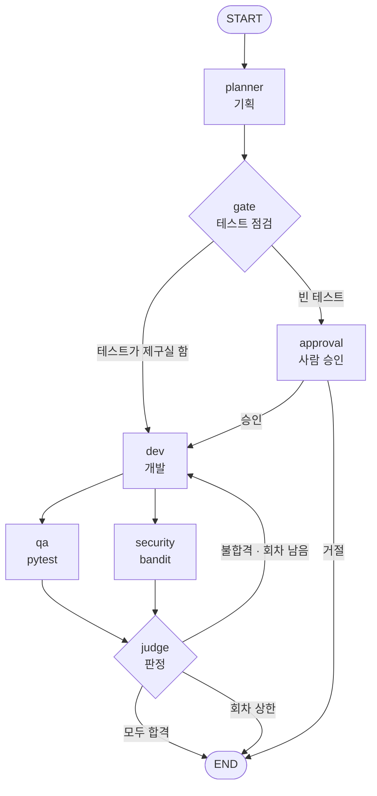
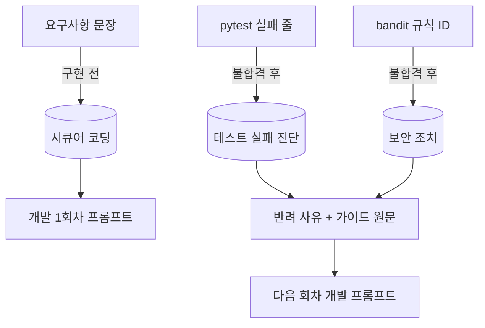
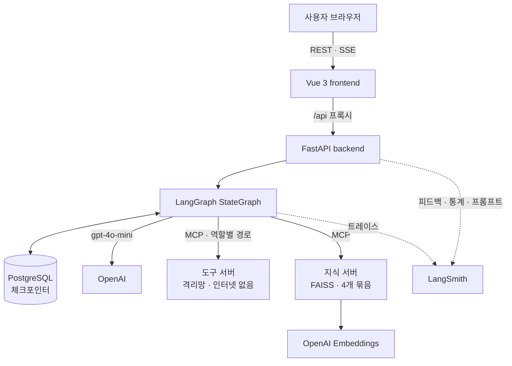

# V-SI : LangGraph 기반 멀티에이전트 가상 SI 개발팀

| | |
|---|---|
| **소속** | SKALA 광주캠퍼스 2반 |
| **고유번호 · 이름** | G042 김승현 |
| **과제** | AI Mini-Project · 과제 2 (신규 프로젝트 개발) |
| **저장소** | https://github.com/skeey66/V-SI |
| **작성일** | 2026-10-22 |

V-SI 는 작은 소프트웨어 회사를 AI 에이전트로 꾸린 서비스입니다. 사용자가 만들고 싶은 기능을 문장으로
적으면 기획 · 개발 · QA · 보안 네 팀이 차례로 일을 받아 명세와 테스트를 쓰고, 코드를 만들고, 실제로
테스트와 보안 검사를 돌립니다. 검사에 떨어지면 이유를 들고 개발팀으로 되돌아가 고치고, 마지막에는
사람이 결과물을 검수합니다.


<sub>"지뢰찾기 게임 로직을 만들어 주세요" 를 실제로 요청한 녹화입니다. 1회차에 QA 와 보안이 모두 반려했고,
2회차에 고쳐서 44초 만에 완료됐습니다. 에이전트가 일하는 구간은 4배속, 대기 구간은 건너뛰었습니다.</sub>

## 목차

1. [문제 개선 및 신규 구현 사항](#1-문제-개선-및-신규-구현-사항)
2. [화면 구성](#2-화면-구성)
3. [적용 기술 요소](#3-적용-기술-요소)
4. [구현 결과](#4-구현-결과)
5. [교훈](#5-교훈)
6. [부록 — 실행 방법](#부록--실행-방법)

---

## 1. 문제 개선 및 신규 구현 사항

### 1-1. 기존 시스템의 문제점

이 프로젝트는 직접 만들었던 V-SI 첫 버전을 다시 설계한 것입니다. 첫 버전에서는 네 에이전트가 각자 독립
컨테이너로 떠서 A2A 프로토콜로 일을 주고받았고, 흐름은 직접 만든 오케스트레이터(상태 기계, DB 아웃박스,
리컨실러)가 관리했습니다. 동작은 했지만 다음과 같은 한계가 있었습니다.

| 문제 | 내용 |
|---|---|
| 느린 처리 | 로컬 `qwen3:8b` 모델로 요구사항 한 건에 10~20분이 걸렸습니다 |
| 무거운 오케스트레이션 | 상태 전이, 재시도, 장애 복구를 전부 직접 구현해 흐름 제어 코드만 3,221줄이었습니다 |
| 관측의 한계 | 서비스 간 추적(Jaeger)은 있었지만 토큰, 비용, 사용자 만족도는 볼 수 없었습니다 |
| 보안 지적을 못 고침 | bandit 이 문제를 찾아도 개발 에이전트가 고치는 방법을 몰라 회차를 소진했습니다 |
| 사용자 경험 | 진행 중 LLM 출력이 보이지 않았고, 결과를 받아도 평가할 방법이 없었습니다 |

### 1-2. 해결 과제

1. 협업 흐름을 LangGraph `StateGraph` 로 옮겨, 흐름이 그래프 한 장으로 읽히게 한다
2. 역할별 권한이 나뉜 MCP 도구 서버는 그대로 살리고, RAG 지식 서버를 MCP 로 추가한다
3. FastAPI 와 SSE 로 진행 상황과 LLM 토큰을 실시간으로 보여준다
4. Vue 화면에서 요청 · 진행 · 검수까지 처리하고, LangSmith 로 비용과 품질을 관리한다
5. 같은 입력으로 Before / After 를 실측해 개선을 숫자로 확인한다

### 1-3. 구현 · 개선한 핵심 기능

| 기능 | 설명 |
|---|---|
| 자동 개발 파이프라인 | 요구사항 하나로 명세, 인수 테스트, 구현, 검사까지 자동으로 진행합니다 |
| 실행 기반 판정 | 합격과 불합격은 모델의 판단이 아니라 `pytest` · `bandit` 의 종료코드로 정합니다 |
| 반려 루프와 반려 기억 | 불합격이면 사유와 함께 개발로 되돌립니다. 이전 회차의 지적도 함께 넘겨 같은 실수를 반복하지 않게 합니다 |
| 단계별 RAG | OWASP · CWE · bandit · pytest · Python 공식 문서와 사내 가이드를 검색해, 구현 전에는 시큐어 코딩 가이드를, 불합격 뒤에는 원인별 조치 가이드를 줍니다 |
| 사람 승인 | 기획이 쓴 테스트가 아무것도 검사하지 않으면 그래프를 멈추고 사람에게 묻습니다 |
| 실시간 진행 화면 | 3D 사무실, 타임라인, 에이전트별 출력이 SSE 로 흐릅니다 |
| 납품 검수 | 결과물을 승인하거나 사유를 골라 보완을 요청하면 검수 도장으로 남고 LangSmith 에 기록됩니다 |
| 관리자 | 실행 통계와 비용, 검수 의견, 프롬프트 버전, RAG 단계를 한 화면에서 관리합니다 |
| 장애 복구 | 서버가 죽어도 Postgres 체크포인트에서 이어서 실행하고, 재시작하면 작업 목록을 복원합니다 |

---

## 2. 화면 구성

화면은 세 개입니다. 요청을 넣는 **메인**, 진행을 지켜보고 결과를 검수하는 **실행 상세**, 운영자가 보는
**관리자**입니다. 디자인은 "가상 SI 회사의 결재 서류"를 콘셉트로 잡았습니다. 요청은 작업 지시서로,
결과는 납품 검수서로, 사람의 판단은 인주색 도장으로 표현했습니다.

### 메인 — 작업 지시서


첫 화면의 중심은 요청 입력란입니다. 오른쪽 위의 결재란(기획 · 개발 · QA · 보안)은 요청 하나를 네 팀이
차례로 처리한다는 것을 보여줍니다. 오른쪽에는 진행 중 · 승인 대기 · 납품 완료 · 보완 필요 건수와 평균
처리 시간을, 아래에는 처리 순서와 최근 작업 목록을 둡니다. 작업 목록은 서버가 재시작돼도 체크포인트에서
복원됩니다.

### 실행 상세 — 3D 사무실


요청을 넣으면 3D 사무실에서 진행이 보입니다. 일하는 팀은 모니터가 켜지고, 일이 넘어가면 캐릭터가 서류를
들고 다음 팀 자리로 걸어갑니다. 반려되면 빨간 서류를 들고 돌아옵니다. 한 건이 20초 안팎에 끝나서 걷는
장면을 놓치기 쉬우므로, 끝난 실행은 **다시 보기**로 천천히 재생할 수 있습니다.


### 실행 상세 — 타임라인과 에이전트 출력


왼쪽 타임라인에는 착수 · 도구 호출 · 결과 · 판정 · 검색이 시간순으로 쌓이고, 오른쪽에는 각 에이전트의
LLM 출력이 토큰 단위로 흐릅니다. 위 화면은 지뢰찾기 1회차입니다. 보안 검사가 `random` 사용(B311)으로
실패하자 보안 조치 지식에서 bandit 공식 문서, 사내 가이드, MITRE CWE-330 세 건을 찾아 개발에게
넘겼습니다. 검색 결과마다 유사도와 출처가 함께 표시됩니다.

### 실행 상세 — 납품 검수서


실행이 끝나면 자동 검사 결과(QA · 보안)와 결과물 파일을 한 장의 검수서로 보여줍니다. 파일마다 명세 ·
인수 테스트 · 구현 중 어느 것인지 표시됩니다. 오른쪽 검수 확인에서 결과물을 승인하거나, 사유(요구사항과
다름 · 테스트 부족 · 코드 품질 · 보안 우려 · 너무 느림)를 골라 보완을 요청할 수 있습니다. 제출하면 아래처럼
검수 도장이 찍히고, 같은 내용이 LangSmith 피드백으로 기록됩니다.


### 관리자


관리자 화면의 숫자는 모두 LangSmith 에 쌓인 실행 기록에서 읽어 옵니다. 실행 수 · 성공률 · 평균과 p95 지연 ·
토큰 · 비용을 집계하고, 사용자들이 남긴 검수 의견을 모아 보여줍니다. 실행마다 LangSmith 트레이스로
바로 가는 링크가 있습니다. 여기서 RAG 단계를 켜고 끄거나, 기획 프롬프트를 새 버전으로 올리고 바꿀 수 있습니다.

---

## 3. 적용 기술 요소

### 3-1. Multi-Agent & LangGraph



네 에이전트는 각각 `create_agent` 로 만든 ReAct 하위 그래프이고, 바깥 그래프가 이들을 잇습니다.
역할마다 프롬프트와 MCP 접속 경로가 다르기 때문에 쓸 수 있는 도구도 구조적으로 다릅니다. 예를 들어
개발 에이전트의 도구 목록에는 `run_tests` 가 아예 없어서, 자기가 만든 코드를 스스로 합격시킬 수 없습니다.

| 요소 | 구현 |
|---|---|
| 전문 서브에이전트 분리 | 기획 · 개발 · QA · 보안이 각각 독립된 ReAct 에이전트. 역할별 프롬프트와 역할별 MCP 도구 |
| 병렬 실행 | QA 와 보안은 서로의 결과가 필요 없어 동시에 돌고(fan-out), 판정은 둘이 모두 끝난 뒤 실행(fan-in) |
| 동적 재계획 | 판정이 불합격이면 실패 사유와 이전 회차의 지적을 상태에 담아 개발로 되돌립니다. 개발은 매 회차 새 지적을 보고 계획을 다시 세웁니다 |
| Human-in-the-loop | `interrupt()` 로 그래프를 멈추고, 사용자가 승인하면 `Command(resume=...)` 로 이어갑니다 |
| 결정적 판정 | 다음 단계를 LLM supervisor 가 고르지 않고, `judge` 노드가 도구 종료코드로 정합니다. 모델이 "통과했다고 생각한다"는 이유로 통과되는 경로를 없애기 위한 선택입니다 |
| 실행 상한 | 회차 3, 에이전트 턴 8, 시간 예산 300초, 도구 호출 90초, 응답 2,000토큰 |

코드는 [`backend/lg_agent/graph.py`](backend/lg_agent/graph.py) 와 [`backend/lg_agent/nodes/`](backend/lg_agent/nodes/) 에 있습니다.

### 3-2. MCP — Tool · Resource · Prompt

MCP 서버를 두 개 운영합니다. 하나는 코드를 쓰고 실행하는 도구 서버이고, 다른 하나는 RAG 를 담당하는
지식 서버입니다.

| 서버 | 기능 | 내용 |
|---|---|---|
| 도구 서버 `mcp_servers/tool_server` | Tool 7종 | `write_file` `read_file` `list_files` `run_tests` `run_security_scan` `run_lint` `check_acceptance_tests`. 역할마다 별도의 MCP 인스턴스(`/mcp/planner/` 등)에 허용된 도구만 등록합니다 |
| 지식 서버 `mcp_servers/knowledge_server` | Tool | `search_guides(query, collection, k)` — 지식 묶음 하나에서 의미 검색. 결과마다 출처를 붙입니다 |
| | Resource | `guide://{collection}/{doc_id}` — 문서 원문 조회 |
| | Prompt | `security_fix_request(bandit_output)`, `test_design_brief(requirement)` — 검색 결과를 붙인 요청문 |

도구 서버는 인터넷과 API 키가 없는 격리망 컨테이너에서 돌아갑니다. LLM 이 쓴 코드는 이 안에서만 실행됩니다.
모델에게 보이는 도구 스키마에서는 작업 공간 ID 를 지우고 호출할 때 서버 쪽 값으로 채우기 때문에, 모델이
다른 요구사항의 파일을 가리킬 방법이 없습니다. 공식 `langchain-mcp-adapters` 가 `mcp 2.2` 와 호환되지 않아,
MCP 도구를 LangChain 도구로 감싸는 얇은 어댑터([`mcp_tools.py`](backend/lg_agent/mcp_tools.py))를 직접 만들었습니다.

### 3-3. RAG — Vector DB 기반 의미 검색과 문서 주입

공개 문서를 수집해 지식 묶음 네 개를 만들었습니다. 에이전트는 일하기 전(예방)과 실패한 뒤(진단)에
이 지식을 검색합니다.

| 지식 묶음 | 쓰는 곳 | 검색 질의 | 사내 가이드 | 수집한 공개 문서 |
|---|---|---|---|---|
| 시큐어 코딩 | 개발 · 구현 전 | 요구사항 문장 | 11 | OWASP Cheat Sheet 10, Python 보안 문서 7 |
| 테스트 실패 진단 | QA · 불합격 후 | pytest 실패 줄 | 15 | pytest 문서 4, Python 내장 예외 |
| 보안 조치 | 보안 · 불합격 후 | bandit 규칙 ID 와 문장 | 25 | bandit 공식 규칙 설명 52, MITRE CWE 21 |
| 테스트 설계 | 기획 · 테스트 작성 전 (기본 꺼짐) | 요구사항 문장 | 15 | pytest 문서 4 |

문서 165개를 청크 752개로 나눠 묶음별 FAISS 인덱스에 넣었습니다. 수집기
[`scripts/collect_knowledge.py`](scripts/collect_knowledge.py) 가 원문을 내려받고, 출처와 라이선스를
[`corpus/SOURCES.md`](mcp_servers/knowledge_server/corpus/SOURCES.md) 에 남깁니다.



- **청크** — 짧은 사내 가이드는 통째로, 긴 문서는 절 단위로 최대 1,200자까지 자릅니다. Java · Rust 처럼 다른 언어 전용 절은 수집할 때 뺍니다.
- **임베딩** — OpenAI `text-embedding-3-small` 과 FAISS `IndexFlatIP`(코사인 유사도). 바뀐 묶음만 다시 임베딩하도록 캐시합니다. 전체 임베딩 비용은 약 $0.004 입니다.
- **검색** — 의미 검색 점수에, 규칙 ID · CWE · 오류 이름 같은 식별자가 질의에 있으면 가산점을 줍니다. 한국어 일반 단어에는 작은 가산점만 줍니다. 임계값보다 낮은 문서는 버리고, 한 문서에서는 청크 하나만 씁니다.
- **주입** — 출처와 함께 프롬프트에 넣습니다. 불합격 뒤의 가이드는 모델이 요약하며 빠뜨려도 개발이 원문을 받도록 반려 사유에 그대로 붙입니다.

**단계별로 켜고 끄며 효과를 측정했습니다.** 아래는 LLM-as-a-Judge 실험 결과로, 조건마다 요구사항 5개를
2번씩 돌렸습니다.

| 데이터셋 | 지표 | RAG 끔 | 4단계 전부 | 기본 3단계 |
|---|---|---|---|---|
| 보안 함정 (셸 명령 · eval · md5 · random · f-string SQL) | 1회차 보안 통과 | 1/10 | 5/10 | 4/10 |
| | 완료 | 5/10 | 6/10 | 6/10 |
| | 1회차 QA 통과 | 8/10 | 5/10 | 5/10 |
| 일반 (장바구니 · 회문 · 두 번째 최댓값 · 온도 · 이메일) | 완료 | 10/10 | 8/10 | 10/10 |
| | 평균 회차 | 1.3 | 2.0 | 1.1 |
| | 1회차 QA 통과 | 7/10 | 3/10 | 9/10 |

가장 효과가 컸던 것은 시큐어 코딩 RAG 입니다. 개발이 처음부터 안전한 방식으로 구현하면서 1회차 보안
통과가 1/10 에서 4~5/10 으로 올랐습니다.

반대로 테스트 설계 RAG 는 역효과였습니다. 체크리스트에서 "한글 입력도 테스트하라"는 항목을 본 기획이
`is_palindrome("한글가나다한글가나다") == True` 라는 테스트를 썼는데, 이 문자열은 회문이 아닙니다.
기대값이 틀린 테스트는 개발이 고칠 수 없어서 3회차 내내 반려됐습니다. 지시와 임계값을 고친 뒤에도 일반
요구사항의 완료율이 10/10 에서 8/10 으로 떨어져서, 기본값에서 뺐습니다.

보안 함정 데이터셋에서 1회차 QA 통과가 줄어든 것은 요구사항과 보안 정책이 충돌하기 때문입니다. 가이드를
따라 md5 대신 sha256 으로 구현하면, md5 결과를 기대하는 테스트는 실패합니다.

### 3-4. 아키텍처와 코드 품질

```
V-SI/
├── frontend/          Vue 3 화면 (views · components · office(3D) · api)
├── backend/
│   ├── lg_api/        FastAPI — REST · SSE · 관리자 API
│   └── lg_agent/      LangGraph — graph · nodes · deps · rag · mcp · prompts
├── mcp_servers/       도구 서버 · 지식 서버
├── tests/             단위 · 통합 테스트
├── scripts/           실측 · LLM-as-a-Judge 평가 · 문서 수집
└── legacy/            첫 버전 (A2A) — 비교용
```

- **모듈화** — 노드, 상태, 의존성, RAG, MCP 연동, 프롬프트, 설정을 파일 단위로 나눴습니다.
- **의존성 주입** — 노드는 LLM 과 MCP 를 직접 만들지 않고 `Deps` 로 받습니다([`deps.py`](backend/lg_agent/deps.py)). 그래서 테스트에서는 가짜 LLM 과 가짜 도구를 꽂아 그래프 전체를 네트워크 없이 돌릴 수 있습니다.
- **단위 테스트** — 새로 작성한 테스트는 파이썬 33개(그래프 흐름과 RAG 단계 12, API 11, 지식 인덱스 10)와 프런트엔드 39개(SSE 파서, 3D 사무실 상태, 이벤트 변환 등)입니다. 전체 파이썬 테스트 328개가 통과하며, 실제 API 를 부르지 않아 비용이 들지 않습니다.
- **CI** — GitHub Actions 에서 LangGraph 와 Vue 테스트를 따로 실행합니다.

### 3-5. 관측 가능성과 평가 — LangSmith

**모든 실행이 LangSmith 에 트레이스로 남습니다.** 아래는 앞의 지뢰찾기 요청을 LangSmith 에서 연 화면입니다.


왼쪽 트리가 그래프가 실제로 돈 순서입니다. `vsi-graph` 아래에 `planner`, `gate`, `dev` … 노드가 있고,
각 노드 안에서 어떤 LLM 을 몇 초 동안 몇 토큰으로 불렀는지(`ChatOpenAI gpt-4o-mini`), 어떤 MCP 도구를
불렀는지(`write_file`, `list_files` 등)가 단계별로 보입니다. `gate` 아래의 `_after_gate` 는 조건 분기가
어느 쪽으로 갔는지를 나타냅니다. 오른쪽에는 그래프에 들어간 상태와 끝난 상태가 표시됩니다. 이 실행은
`revision 2`, `status accepted` 로 끝났습니다. 상단 요약에서 이 요청 한 건이 44초, 3만 9백 토큰,
약 $0.0049 였고 프롬프트 캐시 적중률이 56% 였다는 것도 바로 확인할 수 있습니다.

LangSmith 는 트레이싱 외에도 다음 용도로 씁니다.

| 용도 | 내용 |
|---|---|
| 트레이싱 | 실행마다 `requirement_id`, RAG 설정, 프롬프트 버전을 메타데이터로 붙여 걸러 보고 비교합니다 |
| 관리자 통계 | 서비스의 관리자 화면이 LangSmith API 에서 실행 수 · 성공률 · 지연 · 토큰 · 비용을 읽어 집계합니다 |
| 사용자 피드백 | 검수 확인 결과(승인 · 보완 요청, 사유, 의견)를 트레이스에 `user_score` 피드백으로 붙입니다 |
| 프롬프트 관리 | 기획 프롬프트를 Prompt Hub(`vsi-planner`)에 버전별로 올리고, 재배포 없이 활성 버전을 바꿉니다 |
| 평가 | `vsi-eval`, `vsi-eval-security` 데이터셋으로 LLM-as-a-Judge 실험을 돌리고 결과를 비교합니다 |

**LLM-as-a-Judge.** 이 서비스의 합격 판정은 테스트 종료코드입니다. 모델의 주관은 배제하지만, 테스트가
요구사항을 덜 담고 있으면 그대로 통과한다는 약점이 있습니다. 그래서 테스트 통과와 별개로, LLM 심판이 명세 ·
테스트 · 구현을 읽고 요구사항을 얼마나 충실히 반영했는지 1~5점으로 매기게 했습니다([`scripts/eval_judge.py`](scripts/eval_judge.py)).
처음 돌린 실험 결과는 다음과 같습니다.

| 요구사항 (데이터셋 `vsi-eval`) | 결과 | 회차 | 충실도 | 심판의 근거 |
|---|---|---|---|---|
| 장바구니 합계, 5만원 이상이면 배송비 할인 | 완료 | 1 | 5 | 경계값 50,000원 테스트 포함 |
| 회문 판별 (대소문자와 공백 무시) | 완료 | 2 | 5 | 조건을 모두 검사 |
| 두 번째로 큰 값, 부족하면 None | 완료 | 1 | 5 | 조건을 모두 검사 |
| 섭씨를 화씨로, 절대영도 미만이면 ValueError | 완료 | 2 | 5 | 예외 처리와 변환을 모두 검사 |
| 이메일 형식 검사, 공백이면 False | 회차 상한 | 3 | 4 | `user@domain..com` 같은 경계값 테스트 부족 |

다섯 건 중 네 건이 완료됐고 충실도 평균은 4.8점이었습니다. 이메일 문항에서는 자동 판정(회차 상한)과
심판의 지적(경계값 부족)이 같은 약점을 가리켰습니다.

### 3-6. 기타 적용 기술

| 기술 | 사용처 |
|---|---|
| SSE 스트리밍 | 노드 진행, 도구 호출, 판정, RAG 검색, LLM 토큰을 실시간으로 보냅니다. 연결이 끊겨도 마지막 이벤트 다음부터 이어 받습니다 |
| Postgres 체크포인터 | 노드가 끝날 때마다 상태를 저장합니다. 서버가 죽어도 마지막 노드부터 재개하고, 재시작하면 작업 목록을 복원합니다 |
| three.js | 3D 사무실. 첫 버전의 장면 코드를 Vue 로 옮기고, 새 이벤트를 기존 형식으로 바꾸는 변환기를 붙였습니다 |
| Docker 격리 | LLM 이 쓴 코드는 인터넷과 API 키가 없는 컨테이너에서만 돕니다. 서비스 포트는 이 컴퓨터(`127.0.0.1`)에만 열었습니다 |

---

## 4. 구현 결과

### 4-1. 전체 아키텍처



### 4-2. 시연 시나리오 — 지뢰찾기 게임 로직

맨 위 GIF 의 요청이 실제로 어떻게 처리됐는지 단계별로 정리하면 다음과 같습니다.

| 단계 | 무슨 일이 있었나 |
|---|---|
| 요청 | 메인 화면에서 "지뢰찾기 게임 로직을 만들어 주세요. 보드 생성, 주변 지뢰 수, 칸 열기(연쇄 열기), 승리 · 패배 판정" 을 입력 |
| 기획 | `spec.md` 와 인수 테스트 5개(보드 생성 · 주변 지뢰 수 · 칸 열기 · 승리 · 패배)를 작성. 테스트 점검을 통과 |
| 1회차 개발 | `minesweeper.py` 를 작성. 지뢰 위치를 `random` 으로 정함 |
| 1회차 검사 | QA 불합격 — 지뢰가 무작위라 "(2, 2) 는 지뢰가 아니다" 테스트가 운에 따라 실패. 보안 불합격 — `random` 사용(B311). 두 지식 묶음에서 조치 가이드를 찾아 반려 사유에 붙임 |
| 2회차 개발 | 가이드를 따라 `secrets` 로 바꾸고 테스트가 기대하는 동작에 맞춤 |
| 2회차 검사 | QA · 보안 모두 합격. 44초 만에 완료, 구현 45줄 |

이 시연에서 반려 루프, 단계별 RAG, 결정적 판정이 한 번에 동작하는 것을 확인할 수 있습니다. 결과물은
pytest 로 검사할 수 있는 게임 로직 모듈이며, 게임 화면(GUI)은 만들지 않습니다.

### 4-3. Before / After

같은 요구사항을 개선 전후로 실행해 비교했습니다. 모델은 모두 `gpt-4o-mini` 이고, 원자료는
`docs/lg/bench-*.json` 과 LangSmith 실험에 있습니다.

**기획 프롬프트.** 처음에는 모델이 "마지막에 `check_acceptance_tests` 를 호출해라" 라는 지시를 테스트 파일
안의 파이썬 코드로 적어 버려서, 개발이 고칠 수 없는 오류가 났습니다. 이 도구를 게이트 노드가 직접 부르도록
구조를 바꾸고 기획 프롬프트를 고쳤더니, 같은 요구사항 3개를 2번씩 돌렸을 때 완료가 0/6 에서 6/6 이 됐고
건당 비용은 $0.0056 에서 $0.0010, 시간은 45.6초에서 12.1초로 줄었습니다.

**반려 기억.** md5 요구사항에서 보안("md5 금지")과 QA("md5 값을 기대")의 판정이 회차마다 번갈아 뒤집혔습니다.
개발이 직전 회차의 지적만 보고 고쳤기 때문입니다. 이전 회차의 지적도 함께 넘기도록 바꿔 이 진동을 막았습니다.

**RAG.** 기본 3단계를 켜면 보안 함정 요구사항의 1회차 보안 통과가 1/10 에서 4/10, 완료가 5/10 에서 6/10 으로
늘었습니다. 일반 요구사항은 완료율 10/10 을 유지하면서 평균 회차가 1.3 에서 1.1 로 줄었습니다.

**스트리밍.** 처음에는 하위 그래프 안의 LLM 토큰이 바깥으로 전혀 나오지 않았습니다. `subgraphs=True` 로
바꾼 뒤 요구사항 한 건에서 토큰 이벤트 760개가 화면으로 흐릅니다.

**구조.** 흐름 제어 코드가 3,221줄에서 전환 시점 1,111줄로 줄었습니다. 처리 시간은 10~20분에서 10~30초가
됐지만, 모델이 달라졌으므로(로컬 qwen3:8b → gpt-4o-mini) 구조만의 효과로 볼 수는 없습니다. 장애 복구는
리컨실러의 자동 재시도에서 체크포인트 기반 재개로 바뀌었고, 서버를 강제 종료한 실험에서 끝난 노드는
건너뛰고 이어서 완료되는 것을 확인했습니다.

개발 · 시연 · 측정 · 평가에 쓴 OpenAI 비용은 모두 합쳐 약 $0.49 입니다(LangSmith 루트 실행 673개 합계).
일반적인 요구사항 한 건은 약 $0.001, 지뢰찾기처럼 한 번 반려되는 요청은 약 $0.005 입니다.

---

## 5. 교훈

### 5-1. 한계와 트레이드오프

| 선택 | 얻은 것 | 잃은 것 |
|---|---|---|
| LLM supervisor 대신 결정적 판정 | 근거 없는 통과가 구조적으로 불가능하고 판정 비용이 들지 않음 | 상황에 따라 순서를 바꾸는 유연성 (예: 보안만 다시 돌리기) |
| 네 에이전트를 한 그래프의 노드로 | 코드가 1/3 로 줄고 흐름이 그래프 한 장으로 읽힘 | 에이전트별 독립 배포와 확장, 컨테이너 단위 장애 격리 |
| 체크포인터 복구 | 상태 보존, 끝난 노드는 다시 돌지 않음 | 자동 재시도는 없고, 진행 타임라인은 메모리에만 있어 재시작하면 사라짐 |
| 단계별 RAG | 시큐어 코딩으로 1회차 보안 통과 1/10 → 4/10 | 프롬프트가 길어지고 지식 서버를 하나 더 운영해야 함. 검색한 문서가 오히려 잘못된 테스트를 만들 수 있어 단계마다 실측이 필요 |
| 테스트 종료코드로 판정 | 모델의 주관 배제 | 테스트 품질에 그대로 의존. LLM 심판으로 보완했지만 심판이 생성 모델과 같은 계열이라 점수가 후할 수 있음 |
| 공식 MCP 어댑터 대신 자체 어댑터 | `mcp 2.x` 와 호환 | 공식 어댑터의 콜백과 리소스 로딩을 직접 관리해야 함 |

에이전트가 풀 수 없는 문제도 있었습니다. "비밀번호를 md5 로 해시하라" 는 요구사항은 어떤 설정에서도
완료되지 않았습니다. 요구사항 자체가 보안 정책과 충돌하기 때문입니다. 회차 상한이 손실을 제한할 뿐,
이런 문제는 결국 사람이 결정해야 합니다.

### 5-2. 향후 추가 개선 사항

1. **정책 충돌 사전 감지** — 위험한 방식을 지시하는 요구사항은 개발에 들어가기 전에 사람에게 묻는다
2. **테스트 기대값 검산** — 같은 테스트가 두 회차 연속 실패하면 테스트가 틀렸을 가능성을 사람에게 알린다
3. **과거 성공 사례 RAG** — 검수에서 승인된 명세와 테스트를 기획의 예시로 검색한다
4. **이벤트 영속화와 자동 재개** — SSE 이벤트를 DB 에 남기고, 멈춘 실행을 서버가 스스로 이어서 실행한다
5. **심판 모델 분리** — 생성 모델과 다른 계열의 심판으로 평가 편향을 줄인다
6. **인증** — 지금은 API 에 인증이 없어 로컬 바인딩으로만 막고 있다

### 5-3. 수행 소감

<!-- 아래는 초안입니다. 본인의 말로 고쳐 주세요. -->

가장 큰 개선은 모델을 믿지 않는 구조에서 나왔습니다. 기획 프롬프트의 한 문장을 모델이 코드로 적어
버리는 바람에 완료율이 0% 였는데, 프롬프트를 다듬는 것보다 판정을 도구가 직접 하도록 구조를 바꾼 것이 더
근본적인 해결이었습니다.

직접 돌려 봐야 보이는 문제도 많았습니다. 판정이 회차마다 뒤집히는 현상, 하위 그래프의 토큰이 화면에
나오지 않는 문제, 서비스 포트가 외부에 열려 있던 문제는 모두 실제로 실행해 보고서야 찾았습니다.

좋아 보이는 기능도 숫자로 확인해야 한다는 것을 배웠습니다. RAG 를 네 단계에 붙였지만 테스트 설계 RAG 는
기대값이 틀린 테스트를 만들어 완료율을 떨어뜨렸습니다. 단계마다 켜고 끄며 측정한 뒤에야 어떤 지식을
언제 줘야 하는지 알 수 있었습니다.

프레임워크로 옮기면서 직접 만든 코드의 3분의 2가 사라졌지만, 그만큼 직접 보장하던 것들(자동 복구, 이벤트
영속성)도 함께 사라졌습니다. 무엇을 얻고 무엇을 내주는지 알고 고르는 것이 설계라는 것을 체감했습니다.

---

## 부록 — 실행 방법

`.env` 에 키를 넣고 Docker 로 실행합니다.

```bash
OPENAI_API_KEY=sk-...
LANGSMITH_API_KEY=lsv2_...
```

```bash
docker compose --profile lg up -d --build postgres workspace knowledge backend frontend
```

화면은 http://localhost:5180, API 문서는 http://localhost:5180/api/docs 에서 볼 수 있습니다.

```bash
pytest tests/lg_agent tests/lg_api tests/knowledge_server        # 가짜 LLM 사용, 비용 없음
cd frontend && npx vitest run
PYTHONPATH=backend python scripts/eval_judge.py --dataset vsi-eval-security --rag on --reps 2
PYTHONPATH=backend python scripts/collect_knowledge.py            # RAG 문서 다시 수집
```

상세 분석은 [`docs/lg/REPORT.md`](docs/lg/REPORT.md), API 명세는 [`docs/lg/api-contract.md`](docs/lg/api-contract.md),
지식 서버 구성은 [`mcp_servers/knowledge_server/README.md`](mcp_servers/knowledge_server/README.md) 에 있습니다.
첫 버전(A2A)은 [`legacy/`](legacy/) 에 비교용으로 남아 있습니다.
